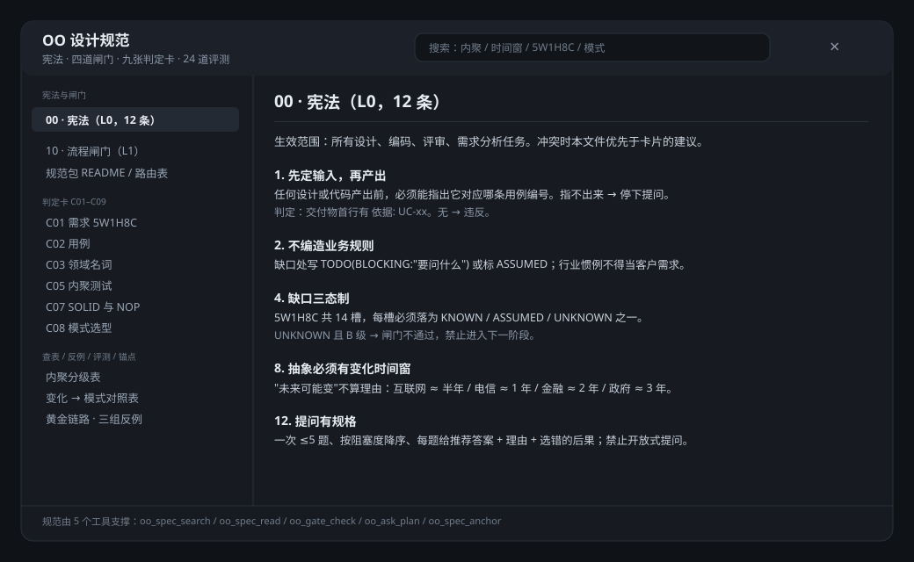

# OO spec

Turns a design method into something the agent can be held to: four gates in a fixed order, nine judgement cards, and a checker that reports what a deliverable is missing instead of praising it.

## What it adds

**One skill, loaded on demand.** `oo-spec` routes the model to the right card for the task at hand — requirement slots, use cases, domain nouns, class mapping, cohesion, coupling, SOLID and over-design, pattern selection, dynamic models — and states the twelve constitution rules it must not break: input first, never invent business rules, gaps in three states, no skipped gates, abstractions need a change point and a time window, questions come in a fixed shape.

**Five tools.**

| Tool | What it answers |
|---|---|
| `oo_spec_search` | Which document says this? Ranked blocks with `docId:line`. |
| `oo_spec_read` | The whole constitution, a gate, a card, a table, a worked example, an eval case, or the anchor table. |
| `oo_gate_check` | What does this deliverable still miss? Per-criterion verdicts with line evidence for G1–G4. |
| `oo_ask_plan` | A compliant question block: at most five gaps, blocking first, each with a recommendation, a reason, the cost of being wrong, and the default used when nobody replies — plus the assumption ledger. |
| `oo_spec_anchor` | The original-text anchor id (`rag #073`) that makes a conclusion checkable. |

**The spec in the app.** A compact `OO 规范` control in the composer tool row opens the whole bundled spec in an overlay: searchable list on the left, rendered document on the right. Nothing is fetched — the documents ship in the package.

## How to use it

- Ask for a design, a review, a requirement analysis, or a "should this class be split" judgement. The skill loads when it matches, and the model can cite cards instead of adjectives.
- After the model produces a requirement table, a domain model, or an implementation mapping, ask it to run `oo_gate_check` on that text. Every failing criterion comes back with a line number, so the fix is a single edit rather than a re-read.
- When requirements are thin, `oo_ask_plan` produces the question block the method demands. Unanswered questions become `ASSUMED-B1`… in the ledger instead of silent guesses.
- Type `OO 规范` in your head and click the composer control when you want the text yourself.

## Limits you should know

- The gate checks are text heuristics, not a parser for your notation. They recognise the shapes the spec prescribes (slot tables with `KNOWN`/`ASSUMED`/`UNKNOWN`, `【用例名称】`/`UC-xx` blocks, `变化点`/`时间窗` next to an abstraction, `实现映射` tables). A deliverable written in another shape will report false gaps; use the criteria as a checklist and the evidence lines as pointers, not as proof.
- The G4 class-parity check compares PascalCase identifiers in the design text with `class`/`interface`/`record`/`enum`/`struct` declarations in the `code` argument. Aliases and generics are not resolved.
- The spec is Chinese-first. Card titles, the skill body, and the checker's explanations are Chinese; the app labels follow the browser language.
- Five tools and one skill are registered. No system prompt text is injected and no conversation state is written, so nothing here changes behaviour until the model loads the skill or calls a tool.

## Credits

The method, the twelve constitution rules, the nine cards, the tables, the worked examples, and the 24 eval cases come from the `oo-spec` package assembled from 《编程的逻辑：如何用面向对象方法实现复杂业务需求》(李运华, 电子工业出版社, 2020) — the bundled files under `spec/` are that package, unmodified apart from packaging.
